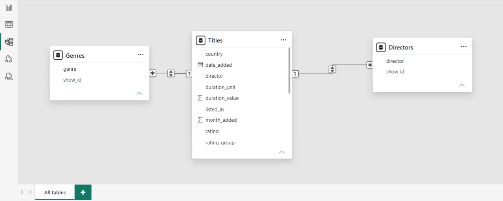

# 🛠️ Task 1: Data Preparation & Star Schema Data Modeling

## 📌 Task Overview
The objective of **Task 1** is to build the data foundation for the entire 6-part Netflix analytics series. This phase focuses on raw dataset profiling, advanced ETL data transformation in Power Query, handling missing data, resolving data quality issues, and constructing a fully normalized **Star Schema Data Model** in Power BI[cite: 3].

---

## 🧹 Key ETL & Data Cleaning Steps (Power Query)

### 1. File Ingestion & Parsing Errors
* **Quoted Line Breaks:** Corrected text parsing issues where multi-line text descriptions caused accidental row splitting during CSV ingestion[cite: 3].
* **Locale Date Conversion:** Standardized date strings (`date_added`) using explicit **English (United States)** locale parsing to ensure seamless `DateTime` conversions across all operating systems[cite: 3].

### 2. Data Deduplication & Whitespace Scrubbing
* Applied whitespace trimming across all textual attributes (`title`, `director`, `cast`, `country`)[cite: 3].
* Deduplicated records based on unique identifiers (`show_id`), reducing the total catalog count down to clean records[cite: 3].

### 3. Missing Value Handling
* Standardized inconsistent null and missing representations[cite: 3].
* Replaced string placeholders like `"Not Given"` in `director` and `country` with a clean `"Unknown"` fallback value[cite: 3].

---

## 🏗️ Star Schema Data Model Architecture

To allow flexible multi-dimensional filtering across titles that belong to multiple genres or directors, multi-valued delimited columns were normalized into dedicated dimension tables[cite: 3].

### Data Dictionary & Table Structure

| Table Name | Table Type | Primary Key / Foreign Key | Description & Content |
| :--- | :---: | :--- | :--- |
| **`Titles` (Fact)** | Fact | `show_id` (PK) | Main titles catalog containing core metadata (title, release year, duration, rating, date added)[cite: 3]. |
| **`Genres` (Dimension)** | Dimension | `show_id` (FK), `genre_id` | Normalized dimension table unpivoting multi-genre strings into individual rows per title[cite: 3]. |
| **`Directors` (Dimension)** | Dimension | `show_id` (FK), `director_id` | Normalized dimension table mapping directors to individual catalog titles[cite: 3]. |

### Data Model Relationships
* **`Titles` 1 ─── * `Genres`** (One-to-Many relationship on `show_id`)[cite: 3]
* **`Titles` 1 ─── * `Directors`** (One-to-Many relationship on `show_id`)[cite: 3]

